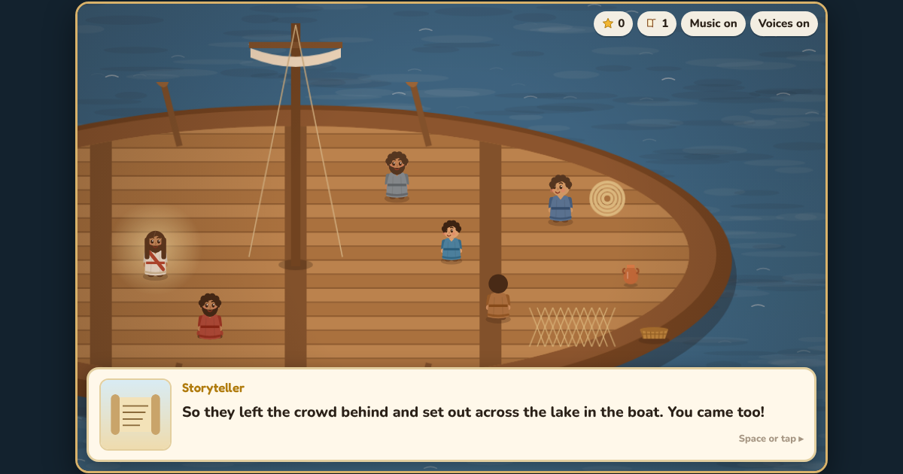

# The Road with Jesus

A kids' adventure game (ages 6 to 12). You walk with Jesus through five stories from the Gospels, help the people you meet, make choices, and hear every character speak.

**Play:** https://kate1819.github.io/travel-with-jesus/

## Chapters

1. **Come, Follow Me:** meet Jesus in Capernaum, help old Tobiah, and watch Peter and Andrew leave their nets (Matthew 4:18–20).
2. **Five Loaves and Two Fish:** find the boy with the lunch, serve the crowd, and gather twelve baskets (John 6:1–14).
3. **The Storm on the Lake:** bail out the boat, wake Jesus, and see Him calm the wind and waves (Mark 4:35–41).
4. **Zacchaeus Comes Down:** be kind to the man nobody likes and help him make things right (Luke 19:1–10).
5. **He Is Risen!:** find the empty tomb, meet the risen Jesus, and run to tell Peter and John (Matthew 28, John 20).

## How to play

- Arrow keys to walk, Space to talk. On a phone or tablet, use the arrow pad or tap where to go.
- Choose a boy or girl, a name, and the hero's look (skin, hair, tunic, pattern, sash and cloak).
- There is no game over. A wrong choice brings gentle guidance from Jesus, and good choices earn kindness stars.
- Jesus' words are collected in a verse journal. Quotes follow the NIV, shortened in a few places.

## Files

- `index.html`: the whole game (graphics, music and story in one file).
- `voice/`: recorded voice lines for each chapter, made with the open Kokoro text-to-speech model.
